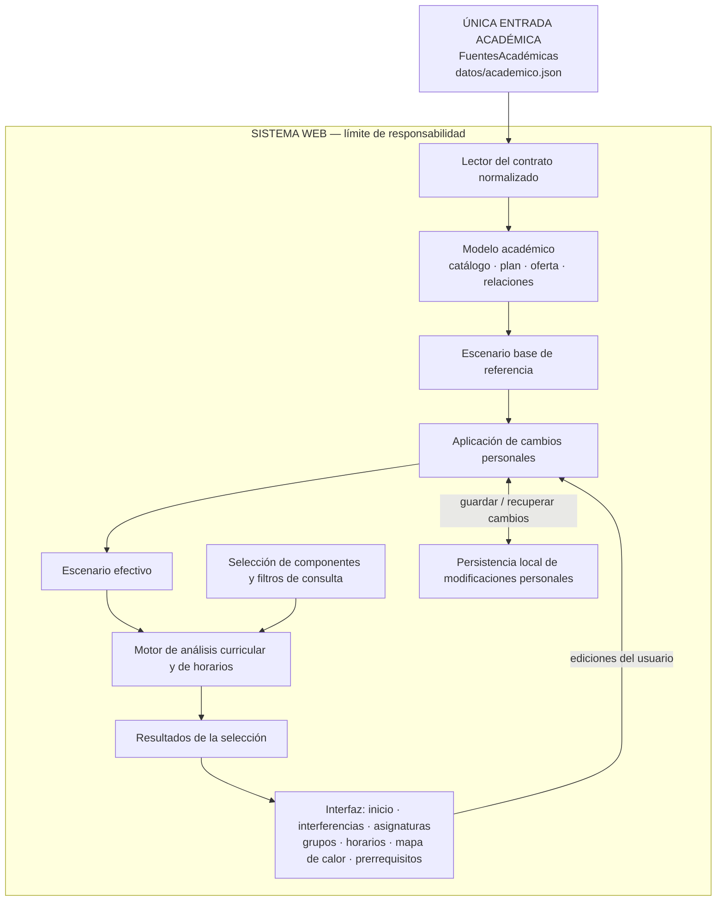

# ARQ-01 — Arquitectura de referencia del sistema

> **Estado:** criterio arquitectónico adoptado para el desarrollo posterior.  
> **Fecha:** 7 de noviembre de 2026.  
> **Alcance:** sistema web de planeación curricular de Mecatrónica, extensible a otros programas.  
> **Arquitectura normativa:** la descrita en este documento. **La implementación v0.4.3 aún no cumple íntegramente esta arquitectura.**

## 0. Regla principal, no negociable

**El sistema recibe una sola entrada académica estandarizada: `FuentesAcadémicas`.**

El artefacto de intercambio se denomina en este documento **`datos/academico.json`** (nombre de ruta objetivo, todavía no implementada). Contiene todos los datos normalizados que la aplicación puede utilizar: asignaturas, planes y mallas, requisitos, oferta y relaciones entre actividades, además de la configuración necesaria.

**Fuera del sistema** quedan por completo la recopilación, lectura, extracción, OCR, transcripción, limpieza, comparación, corrección y **conversión** del catálogo institucional, de la oferta de grupos y de la malla curricular. No constituyen capas ni módulos de la aplicación. Quien produzca el JSON decide cómo convertir las fuentes; la aplicación **no conoce ni necesita conocer** ese proceso.

No habrá una conexión alternativa desde la malla, el catálogo, una fuente sin convertir, `RAW` o cualquier archivo heredado al motor de análisis. **El JSON normalizado es el único punto de entrada de datos académicos**. Los eventos del usuario que personalizan su escenario son operaciones, no fuentes académicas adicionales.

### Diagrama rector: únicamente lo que está dentro del sistema



**Interpretación obligatoria:** la flecha `FuentesAcadémicas → Lector` es **la única entrada académica** al sistema. No deben añadirse flechas laterales ni un segundo canal desde archivos de origen hacia la interfaz, los escenarios, los cálculos o las pruebas de producción.

### Lo que expresamente NO pertenece a este mapa

Las tres fuentes originales (malla curricular, catálogo de asignaturas, oferta de grupos y horarios) y cualquier proceso usado para convertirlas se encuentran **antes y fuera de la frontera**. No se dibujan como componentes internos. Tampoco deben añadirse a la aplicación módulos `ConversorMalla`, `ConversorCatalogo`, `ConversorOferta`, pantallas de importación de fuentes sin normalizar ni adaptadores específicos para PDF/HTML/Excel.

La información sobre su procedencia puede quedar **como metadato** dentro del JSON normalizado. Esa procedencia no es una ruta de lectura alternativa.

## 1. Contrato: qué recibe FuentesAcadémicas

**Un archivo JSON con estructura estable**, independiente del formato y del número de documentos que se hayan usado para producirlo. El JSON representa el estado académico disponible para un programa/plan y una oferta de periodo cuando se conozca.

No son obligatorias las **cantidades** de registros: una colección puede estar vacía y un dato desconocido puede ser `null`. La estructura se valida; la **completitud institucional no se exige**.

| Campo normalizado | Responsabilidad | Regla |
|---|---|---|
| `versionEsquema` | Identifica la forma del contrato | Entero, distinto de la versión de la página y de la fecha de las fuentes |
| `programa` | Identifica programa y plan | Los identificadores se definen en los datos; no en funciones |
| `componentes` | Catálogo de componentes del plan y su inclusión en créditos | Configurable; no se fijan B/C/N o valores numéricos en el motor |
| `catalogo` | Asignaturas institucionales, código, nombre, créditos, tipología y texto cuando exista | No depende de que el curso aparezca en la malla u oferta |
| `malla` | Posiciones curriculares, semestre, componente y carácter | Una posición puede representar una optativa genérica y no tener código de asignatura |
| `requisitos` | Relaciones y mínimos de créditos definidos para un plan | No se copian automáticamente a otros planes; se expresa qué componentes cuentan |
| `oferta` | Oferta por periodo, actividades, grupos y bloques horarios | Se preservan los grupos aunque no tengan bloques |
| `agrupaciones` | Opciones de grupo analizables que relacionan actividades | Solo relaciones explícitas y sustentadas en el dato normalizado |
| `configuracion` | Calendario, filtros disponibles y reglas de comparación | Sin constantes propias de una carrera en el algoritmo |
| `procedencia` | Identificación/fecha de la información si consta | Metadatos opcionales; nunca instrucciones para leer otras fuentes |

**Ejemplo de forma** (ilustrativo, incompleto en contenido académico, no una conversión exhaustiva):

```json
{
  "versionEsquema": 1,
  "programa": {
    "id": "mecatronica",
    "nombre": "Ingeniería Mecatrónica",
    "planId": "acuerdo-6-2022"
  },
  "componentes": [
    { "id": "B", "nombre": "Fundamentación", "enPlan": true },
    { "id": "C", "nombre": "Disciplinar", "enPlan": true },
    { "id": "L", "nombre": "Libre elección", "enPlan": true },
    { "id": "N", "nombre": "Nivelación", "enPlan": false }
  ],
  "catalogo": [
    {
      "codigo": "1000003-B",
      "nombre": "Álgebra Lineal",
      "creditos": 4,
      "tipologiaInstitucional": "B",
      "descripcion": null
    }
  ],
  "malla": [
    {
      "id": "pos-algebra-lineal",
      "codigoAsignatura": "1000003-B",
      "semestre": 2,
      "creditos": 4,
      "componente": "B",
      "caracter": "obligatoria"
    }
  ],
  "requisitos": [],
  "oferta": [],
  "agrupaciones": [],
  "configuracion": {
    "calendario": {
      "dias": ["L", "M", "X", "J", "V", "S"],
      "horaInicio": 6,
      "horaFin": 21
    },
    "componentesComparables": ["B", "C", "N"]
  },
  "procedencia": {
    "catalogo": null,
    "oferta": null,
    "malla": null
  }
}
```

Los identificadores de ejemplo ilustran el contrato: no implican que toda posición curricular tenga código ni que cada fuente tenga la misma cobertura. El esquema completo de cada colección, su cardinalidad y sus reglas de identidad deberán derivarse de este contrato, sin ampliar la frontera de entrada.

### Semántica de datos ausentes

- `null` significa **dato no conocido / no informado**, cuando un campo admite ausencia.
- `[]` significa **no hay registros informados en esa colección**; no autoriza inferir que institucionalmente no existan.
- `0` es un **dato numérico conocido**; no se utiliza como reemplazo automático de una ausencia.
- No se inventan nombres, códigos, requisitos, créditos, agrupaciones, aulas, cupos o horarios.
- Inglés I–IV pertenece a **Nivelación** en este plan; la tipología institucional puede conservar además el código `E`. Son atributos distintos.
- La tipología institucional de un curso y su **componente dentro de un plan** pueden diferir sin contradicción.
- Se permiten asignaturas que solo estén en catálogo, posiciones genéricas sin curso identificado, grupos sin horarios y datos de periodos incompletos.
- Cuando faltan horarios, el motor **no inventa cruces**. La ausencia de un choque detectado con horarios incompletos no demuestra compatibilidad definitiva; no debe disparar avisos por falta de información.

### Identificadores y relaciones

- **Asignatura:** código institucional cuando exista; no se deduce por similitud del nombre.
- **Posición curricular:** ID propio dentro de un plan. No es sinónimo de asignatura.
- **Oferta:** vinculada a un código de asignatura y, cuando exista, a un periodo académico.
- **Grupo de actividad:** identidad contextualizada por oferta, actividad e ID de grupo, no solo por el texto “G1”.
- **Agrupación analizable:** relaciona los grupos de actividad que la fuente normalizada declara compatibles como una opción. No se hacen productos cartesianos entre teorías y laboratorios ni se supone universalmente que dos IDs iguales deban combinarse.
- **Requisitos:** se expresan respecto del plan y sus posiciones; los mínimos numéricos y componentes que cuentan son **datos**, no condiciones incrustadas en funciones.

El sistema **consume** esas relaciones ya representadas en la entrada normalizada. No reconstruye la procedencia ni convierte los formatos originales para resolverlas.

## 2. Componentes internos y responsabilidades (POO como diseño)

| Responsabilidad | Entrada dentro del sistema | Salida | No debe hacer |
|---|---|---|---|
| **Lector del contrato** | Solo `FuentesAcadémicas` | Modelo académico en memoria | Interpretar PDF, HTML, TXT, Excel o tres rutas de fuente |
| **Modelo académico** | Datos normalizados | Consultas a asignaturas, plan, requisitos, oferta y agrupaciones | Fabricar ausencias ni reglas particulares por nombre |
| **Escenario base** | Modelo académico | Selección base analizable | Leer archivos originales ni almacenar resultados precomputados como fuente |
| **Escenario personal** | Referencia + cambios voluntarios | Escenario efectivo | Sobrescribir eliminaciones o ediciones personales por una actualización de referencia |
| **Análisis** | Escenario efectivo + filtros/criterios | Interferencias, compatibilidades calculables y estadísticas | Decidir qué datos institucionales se importan |
| **Presentación** | Resultados y consultas al modelo | Páginas, tablas, mapa de calor, CSV | Recalcular resultados paralelos con reglas diferentes |
| **Persistencia local** | Cambios personales | Datos para reconstruirlos | Tratar una copia antigua de la referencia como fuente autoritativa |

No es necesario crear una clase por entidad ni mantener exactamente estos nombres de clases. La regla vinculante es **una responsabilidad por componente** y dependencias dirigidas desde el contrato hacia los consumidores, nunca en sentido inverso.

### Cálculo y visualización

- Los filtros de Fundamentación, Disciplinar y Nivelación son **selecciones de consulta**, no operaciones de eliminación de información.
- Inicio, Interferencias, Asignaturas, exportaciones, paneles y mapa de calor deben interpretar **la misma selección activa**; no debe persistir una vía de resultados no filtrados en un panel cuando su filtro está desmarcado.
- Grupos, Horarios y Prerrequisitos pueden ofrecer edición/consulta completa del escenario sin ocultar datos por un filtro estadístico.
- Un grupo con varias actividades conserva todos sus bloques **según las agrupaciones explícitas del contrato**.
- No se confunde el número de grupos disponibles con número de estudiantes, capacidad de aulas u ocupación efectiva.
- Los créditos mínimos se comprueban por los componentes y criterios registrados en el plan, no por totales fijos del código.

## 3. Estado de referencia y modificaciones personales

El estado académico normalizado es una **referencia**. Un estudiante puede desactivar grupos, editar horarios, mover asignaturas, cambiar relaciones o construir un escenario hipotético. Estas decisiones no modifican la referencia.

La arquitectura objetivo conserva **operaciones o diferencias personales** vinculadas a identificadores estables. Al cargar una versión posterior de `FuentesAcadémicas` se reconstruye el escenario utilizando la nueva referencia y las modificaciones de la persona.

**Invariantes:**
1. La actualización del archivo académico no se atribuye a una edición personal.
2. Un grupo que la persona eliminó deliberadamente no se restaura por accidente.
3. Los grupos nuevos pueden incorporarse desde la referencia sin redactar una migración por cada asignatura.
4. Los escenarios JSON antiguos merecen una transición explícita y comprobada, no se descartan silenciosamente.
5. Exportar y recuperar un escenario no cambia la interpretación de los datos académicos.
6. `Restablecer` reconstruye desde la referencia normalizada vigente.
7. Las operaciones sobre el escenario **no son otra fuente académica de entrada**: son personalizaciones de datos ya cargados.

## 4. Verificaciones: antes de presentar información

La revisión técnica debe comprobar la **fidelidad al contrato**, no exigir datos que no existen.

- **Estructura:** JSON legible, versión reconocida, tipos de campo correctos e identidades no ambiguas.
- **Referencias:** las relaciones informadas apuntan a las entidades esperadas; las ausentes permitidas permanecen ausentes.
- **Cobertura:** ninguna asignatura, grupo o bloque **elegible según el contrato** se omite sin una exclusión explícita.
- **Horarios:** la prueba compara día, hora de inicio, hora de fin y agrupación; no solo cantidades de bloques.
- **Resultados:** filtros, indicadores, matrices, paneles y CSV utilizan el mismo escenario y selección.
- **Escenarios:** cambios voluntarios se conservan al actualizar la referencia; los nuevos datos disponibles se incorporan sin restaurar eliminaciones.
- **Flexibilidad:** el mismo motor trabaja con otros nombres, componentes, planes, semestres y calendarios.
- **Información incompleta:** un dato ausente no provoca alertas por ausencia ni obliga a completar otros campos.

Errores **técnicos** del contrato (por ejemplo, archivo ilegible o una hora final anterior a la inicial) se distinguen de **vacíos académicos legítimos**. No convertir vacíos de las fuentes en fallos de la interfaz.

## 5. Arquitectura actual versus arquitectura normativa

**Estado actual comprobado (v0.4.3):**
- `index.html` carga `js/datos.js`, `js/modelo.js` y `js/app.js`.
- `js/datos.js` contiene `RAW.asg`, `RAW.gr`, `RAW.bl`, malla y reglas ya preparadas.
- `js/catalogo.js` y `js/oferta-fuente.js` están almacenados como referencias separadas; no son la entrada única de la página.
- `js/fuentes.js` define un objeto de consulta para esas tres estructuras.
- `localStorage` guarda una copia completa del escenario, con migraciones históricas particulares.

**Esto es deuda de transición, NO una excepción permitida al diagrama rector.** No deben interpretarse los archivos históricos como las interfaces que los futuros módulos están autorizados a consumir. No se retirarán durante la publicación de este documento: el cambio de arquitectura requiere una intervención posterior y pruebas de compatibilidad.

### Migración posterior, no iniciada por este documento

1. Cerrar los detalles técnicos del **único contrato de entrada** `FuentesAcadémicas`.
2. Producir externamente un JSON normalizado que represente los datos vigentes.
3. Contrastar la entrada normalizada con los registros que realmente se conocen, sin completar vacíos.
4. Sustituir en el lector de la aplicación la dependencia de `RAW` por la lectura del archivo normalizado.
5. Construir el estado base de forma genérica desde esa entrada.
6. Migrar escenarios personales, conservando modificaciones deliberadas.
7. Asegurar que todos los módulos y pruebas de producción utilicen **una sola vía de datos**; retirar las rutas redundantes.
8. Publicar solo tras verificar consistencia funcional y compatibilidad.

**Importante:** una conversión de PDF/TXT/HTML/Excel a JSON, si se necesita, se ejecuta **fuera de este sistema**. No es una etapa del sistema web, no se muestra en su arquitectura interna y no se implementa como requisito de funcionamiento de la aplicación.

## 6. Aplicación a nuevas funciones

El proyecto puede crecer hacia consulta de descripciones y materiales, comparación temática, preinscripciones voluntarias, estimaciones de demanda o nuevos programas. Esas funciones **no deben crear entradas académicas paralelas**.

Si un módulo futuro necesita información académica adicional, se estudia la ampliación compatible del contrato `FuentesAcadémicas` y se suministra **en ese único archivo normalizado**. El módulo lee el modelo común, no la fuente de origen. Datos personales o de interacción de un usuario, cuando sean necesarios, se mantienen diferenciados de la referencia académica.

El sistema sigue siendo compatible con publicación estática (GitHub Pages). La arquitectura no exige servidor, cuentas ni servicios externos.

## 7. Guía obligatoria para próximas interacciones

Antes de modificar la aplicación o sus datos:

1. Leer **`docs/ARQUITECTURA.md`** y tratar su diagrama de **una sola entrada** como referencia.
2. Indicar qué responsabilidad/capa se cambia y qué información del contrato utiliza.
3. Comprobar si la petición puede resolverse **solo modificando el archivo académico normalizado**, sin tocar algoritmos.
4. No proponer conversores de las tres fuentes como parte del sistema web ni reintroducir conexiones desde archivos originales al cálculo.
5. No introducir constantes institucionales en las funciones cuando son datos del plan o de la oferta.
6. No generar alarmas para compensar vacíos legítimos de información.
7. Realizar pruebas de cobertura, resultados, compatibilidad de escenarios y ausencia de rutas paralelas.
8. Si una nueva necesidad obliga a alterar esta arquitectura, **proponer y justificar primero el cambio al documento**. No establecer silenciosamente una excepción en el código.

**La prioridad arquitectónica es la simplicidad: una entrada académica, un modelo común, un escenario efectivo y resultados coherentes.** No se requieren capas ni validaciones adicionales por costumbre.
