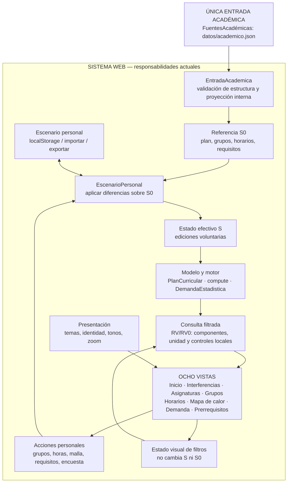

# ARQ-01 — Arquitectura de referencia del sistema

> **Estado:** documento rector de arquitectura, principios y requisitos **vigentes**, contrastados hasta la versión 0.8.0. **La migración ARQ-01 está terminada y cerrada.**  
> **Revisión operativa:** 8 de noviembre de 2026. **Antecedente:** ARQ-01 adoptada el 7 de noviembre de 2026 e integrada desde v0.5.0.  
> **Alcance:** Gestor de horarios, aplicación web estática estudiantil **no oficial** para Ingeniería Mecatrónica. El motor se diseña sin reglas fijas de una carrera, pero esto **no** significa que se hayan habilitado otros programas ni que sea requisito implementarlos.  
> **Propósito:** regresar a **una referencia común** antes de modificar, diagnosticar, limpiar o mantener el sistema. Este documento reúne frontera, flujo efectivo, requisitos, principios, responsabilidades, restricciones y criterios de verificación; no constituye una nueva arquitectura.  
> **Lectura de versiones:** el núcleo se consolidó en 0.7.5 y el saneamiento de ARQ-01 terminó en **0.8.0**. Cerrar la migración **no** declara todavía la versión general 1.0.0. `versionEsquema:1` (entrada), `version:1` (escenario personal) y la versión pública del sitio son independientes.  
> **Fuentes de autoridad:** ARQ-01 fija la norma; `datos/academico.json` fija el dato académico vigente; el código ejecutado y sus pruebas muestran lo realmente implementado. Las decisiones con detalle e historia permanecen en [DEC-01](DECISIONES-Y-ALCANCE.md), la trazabilidad en [MIG-ARQ01](MIGRACION-ARQ01.md) y la situación de publicación en [EST-01](ESTADO-Y-PUBLICACION.md). Ante una contradicción, **investigar y actualizar las afirmaciones**, no atribuir a la aplicación comportamientos inexistentes.

**Presentación multicarrera (UNI-UI-01):** el catálogo cromático de `js/identidad.js` es configuración puramente visual que resuelve el ID de un programa ya presente en `FuentesAcadémicas`. No representa una segunda fuente académica ni habilita carreras sin contrato. Véase [UNI-UI-01](ESTILO-UNIVERSITARIO.md).

### Uso rápido de esta guía

| Antes de… | Consultar aquí | Comprobar después |
|---|---|---|
| Cambiar información del plan o de la oferta | §0–1: entrada única, contrato, vacíos e IDs | Contrato académico, cobertura y horas, sin tocar conversores internos |
| Cambiar algoritmos, consultas o una vista | §2–4: módulos, estados y RF aplicable | Resultados de referencia/escenario, filtros, ocho páginas y casos incompletos |
| Corregir guardado o compatibilidad con archivos anteriores | §3, §4 RF-10/RC-03 y §6: compatibilidad efectiva | Ediciones antiguas y nuevas, sin pérdida silenciosa |
| Analizar una anomalía o un supuesto pendiente | §4.4: **no requisitos** y clasificación de hallazgos | Reproducción y evidencia antes de convertirla en alarma |
| Eliminar código o documentar una versión 1.0 | §5–9: verificaciones, legado, puertas de estabilidad y método | Dependencias, CI, versión y publicación; nunca borrar por nombre antiguo |

**Principio operativo:** no tomar directamente una explicación de README, un documento histórico o un resultado simulado como norma de ejecución cuando contradiga esta referencia y la implementación. Primero precisar **qué observación es real** y qué parte de la documentación necesita actualización.

## 0. Regla principal, no negociable

**El sistema recibe una sola entrada académica estandarizada: `FuentesAcadémicas`.**

El artefacto de intercambio se denomina en este documento **`datos/academico.json`** (archivo normalizado implementado desde la migración v0.5.0). Contiene todos los datos normalizados que la aplicación puede utilizar: asignaturas, planes y mallas, requisitos, oferta y relaciones entre actividades, además de la configuración necesaria.

**Fuera del sistema** quedan por completo la recopilación, lectura, extracción, OCR, transcripción, limpieza, comparación, corrección y **conversión** del catálogo institucional, de la oferta de grupos y de la malla curricular. No constituyen capas ni módulos de la aplicación. Quien produzca el JSON decide cómo convertir las fuentes; la aplicación **no conoce ni necesita conocer** ese proceso.

No habrá una conexión alternativa desde la malla, el catálogo, una fuente sin convertir, `RAW` o cualquier archivo heredado al motor de análisis. **El JSON normalizado es el único punto de entrada de datos académicos**. Los eventos del usuario que personalizan su escenario son operaciones, no fuentes académicas adicionales.

### Diagrama rector: únicamente lo que está dentro del sistema



**Interpretación obligatoria:** la flecha `FuentesAcadémicas → EntradaAcademica` es **la única entrada académica** al sistema. No deben añadirse flechas laterales ni un segundo canal desde archivos de origen hacia la interfaz, los escenarios, los cálculos o las pruebas de producción.

### Lo que expresamente NO pertenece a este mapa

Las tres fuentes originales (malla curricular, catálogo de asignaturas, oferta de grupos y horarios) y cualquier proceso usado para convertirlas se encuentran **antes y fuera de la frontera**. No se dibujan como componentes internos. Tampoco deben añadirse a la aplicación módulos `ConversorMalla`, `ConversorCatalogo`, `ConversorOferta`, pantallas de importación de fuentes sin normalizar ni adaptadores específicos para PDF/HTML/Excel.

La información sobre su procedencia puede quedar **como metadato** dentro del JSON normalizado. Esa procedencia no es una ruta de lectura alternativa.

## 1. Contrato: qué recibe FuentesAcadémicas

**Un archivo JSON con estructura estable**, independiente del formato y del número de documentos que se hayan usado para producirlo. El JSON representa el estado académico disponible para un programa/plan y una oferta de periodo cuando se conozca.

No son obligatorias las **cantidades** de registros: una colección puede estar vacía y un dato desconocido puede ser `null`. La estructura se valida; la **completitud institucional no se exige**.

| Campo normalizado | Responsabilidad | Regla |
|---|---|---|
| `versionEsquema` | Identifica la forma del contrato | Entero, distinto de la versión de la página y de la fecha de las fuentes |
| `programa` | Identifica programa y plan | Los identificadores se definen en los datos; no en funciones |
| `componentes` y `caracteres` | Componentes del plan, inclusión en créditos y caracteres curriculares | Configurables; no se fijan B/C/N ni otros valores institucionales en el motor |
| `catalogo` | Asignaturas institucionales, código, nombre, créditos, tipología y texto cuando exista | No depende de que el curso aparezca en la malla u oferta |
| `malla` | Posiciones curriculares, semestre, componente y carácter | Una posición puede representar una optativa genérica y no tener código de asignatura |
| `requisitos` | Relaciones y mínimos de créditos definidos para un plan | No se copian automáticamente a otros planes; se expresa qué componentes cuentan |
| `oferta` | Oferta por periodo, actividades, grupos y bloques horarios | Se preservan los grupos aunque no tengan bloques |
| `agrupaciones` | Relaciones de grupos por actividad y su elegibilidad para el análisis | `analizable: false` conserva la agrupación como información sin incorporarla a cálculos; ausente equivale a `true` |
| `exclusionesAgrupacion` | Posiciones cuya oferta tiene actividades, pero no hay agrupaciones verificadas | Se conserva el motivo sin fabricar combinaciones ni perder los grupos de `oferta` |
| `configuracion` | Calendario, filtros disponibles y reglas de comparación | Sin constantes propias de una carrera en el algoritmo |
| `procedencia` | Identificación/fecha de la información si consta | Metadatos opcionales; nunca instrucciones para leer otras fuentes |

**Ejemplo de forma** (ilustrativo, incompleto en contenido académico, no una conversión exhaustiva):

```json
{
  "versionEsquema": 1,
  "programa": {
    "id": "mecatronica",
    "nombre": "Ingeniería Mecatrónica",
    "planId": "acuerdo-6-2022"
  },
  "componentes": [
    { "id": "B", "nombre": "Fundamentación", "enPlan": true },
    { "id": "C", "nombre": "Disciplinar", "enPlan": true },
    { "id": "L", "nombre": "Libre elección", "enPlan": true },
    { "id": "N", "nombre": "Nivelación", "enPlan": false }
  ],
  "catalogo": [
    {
      "codigo": "1000003-B",
      "nombre": "Álgebra Lineal",
      "creditos": 4,
      "tipologia": "FUND. OBLIGATORIA",
      "descripcion": null
    }
  ],
  "malla": [
    {
      "id": "pos-algebra-lineal",
      "codigoAsignatura": "1000003-B",
      "semestre": 2,
      "creditos": 4,
      "componente": "B",
      "caracter": "obl"
    }
  ],
  "requisitos": {
    "prerrequisitos": [],
    "minimosCreditos": []
  },
  "oferta": [],
  "agrupaciones": [],
  "configuracion": {
    "calendario": {
      "dias": [
        { "id": "L", "nombre": "Lunes", "corto": "Lun" },
        { "id": "M", "nombre": "Martes", "corto": "Mar" }
      ],
      "horaInicio": 6,
      "horaFin": 21
    },
    "opciones": {
      "componentesComparables": ["B", "C", "N"],
      "distanciasDisponibles": [0, 1, 2],
      "distanciasIniciales": [0, 1]
    }
  },
  "procedencia": {
    "catalogo": null,
    "oferta": null,
    "malla": null
  }
}
```

Los identificadores del ejemplo ilustran el contrato: no implican que toda posición curricular tenga código ni que cada fuente tenga la misma cobertura. **La estructura real adoptada está en `datos/academico.json` y sus pruebas de contrato**; el fragmento ilustrativo no autoriza crear campos académicos obligatorios ni inventar cardinalidades. Las reglas de identidad y la flexibilidad ante vacíos se mantienen según la información normalizada disponible, sin ampliar la frontera de entrada.

### Contrato actual frente a compatibilidad histórica: obligaciones distintas

**Regla normativa:** la existencia de un lector de escenarios de versiones anteriores **NO amplía** el contrato `FuentesAcadémicas` ni obliga a conservar metadatos de una versión antigua. El lector vigente debe abrir una entrada sin campos históricos. La prueba `tests/compatibilidad-opcional.js` compara la proyección y los cálculos **con y sin** estos campos: el análisis actual debe permanecer idéntico.

| Campo / marca | Dónde se encuentra | Obligatorio para la entrada actual | Uso exclusivo o secundario |
|---|---|---|---|
| `versionEsquema: 1` | Raíz de `FuentesAcadémicas` | **Sí**: identifica el esquema normalizado | No equivale a una marca de migración |
| `malla[].id` y `agrupaciones[].id / posicionId` | Referencias académicas normalizadas | **Sí** cuando existe cada registro: identidad estable | También permiten relacionar cambios personales por ID |
| `agrupaciones[].introducidoEn` | Agrupación normalizada, si la procedencia se conserva | **No** | Solo `EscenarioPersonal.migrarAnterior` la usa para reconstruir qué agrupaciones existían en snapshots `{S}` originales |
| `agrupaciones[].componentes[].bloques[].idAnterior` | Bloques de la entrada normalizada, si existe correspondencia histórica conocida | **No** | Permite cotejar el número de bloque de un snapshot antiguo con `ref` actual. Ausente se proyecta como `null` |
| `incrementosOferta` | Contexto transitorio del antiguo lector, cuando se conoce | **No** | La rama opcional de `fixMalla` solo interviene al recuperar `{S}` si hay metadatos de incorporación; la lectura actual no requiere este dato |
| `mig1`–`mig4`, `incorporacionesOferta` | Estado de **un escenario personal antiguo**, no contrato | **No** | Señales internas de cambios ya aplicados en esa copia anterior; no se escriben en `S0` |
| `version:1`, `reqCredCambios`, `reqCredAmbiguos` | Archivo **personal** `escenario-personal` | **No** | Identifican formato y modificaciones o revisiones del usuario; no se transfieren a `FuentesAcadémicas` |
| `analizable:false` | Agrupación normalizada | **Opcional, con efecto funcional actual** | Excluye grupos informativos de los cálculos. Su ausencia equivale a analizable; **no es legado** |

**Límite honesto del soporte histórico:** si un archivo anterior y la referencia disponible carecen de correspondencias para ciertas identidades viejas, no existe evidencia para reconstruir todos los vínculos con precisión. Esa incertidumbre se trata **solo en la recuperación histórica**; nunca se exige completar `introducidoEn` o `idAnterior` en una nueva entrada, nunca se inventan relaciones y nunca se considera inválido el contrato actual por su ausencia. Conservar un lector no convierte sus datos auxiliares en requisitos académicos.

**Separación de responsabilidades al leer código:** `EntradaAcademica` valida estructura presente y proyecta; `fromRaw` adapta el estado actual; `EscenarioPersonal.aplicar` restaura diferencias del formato personal v1; únicamente el camino `{S}` llama a `fixMalla(anterior)` y `migrarAnterior`. Los bloques técnicos que documentan el historial no son ejecutados para construir `S0`.

### Semántica de datos ausentes

- `null` significa **dato no conocido / no informado**, cuando un campo admite ausencia.
- `[]` significa **no hay registros informados en esa colección**; no autoriza inferir que institucionalmente no existan.
- `0` es un **dato numérico conocido**; no se utiliza como reemplazo automático de una ausencia.
- No se inventan nombres, códigos, requisitos, créditos, agrupaciones, aulas, cupos o horarios.
- Inglés I–IV pertenece a **Nivelación** en este plan; la tipología institucional puede conservar además el código `E`. Son atributos distintos.
- La tipología institucional de un curso y su **componente dentro de un plan** pueden diferir sin contradicción.
- Se permiten asignaturas que solo estén en catálogo, posiciones genéricas sin curso identificado, grupos sin horarios y datos de periodos incompletos.
- Cuando faltan horarios, el motor **no inventa cruces**. La ausencia de un choque detectado con horarios incompletos no demuestra compatibilidad definitiva; no debe disparar avisos por falta de información.

### Identificadores y relaciones

- **Asignatura:** código institucional cuando exista; no se deduce por similitud del nombre.
- **Posición curricular:** ID propio dentro de un plan. No es sinónimo de asignatura.
- **Oferta:** vinculada a un código de asignatura y, cuando exista, a un periodo académico.
- **Grupo de actividad:** identidad contextualizada por oferta, actividad e ID de grupo, no solo por el texto “G1”.
- **Agrupación registrada:** relaciona los grupos de actividad que la fuente normalizada declara compatibles como una opción. No se hacen productos cartesianos entre teorías y laboratorios ni se supone universalmente que dos IDs iguales deban combinarse.
- **Elegibilidad:** `analizable: false` conserva una agrupación para consulta, pero la excluye de interferencias, matrices, mapa de calor e indicadores horarios. Si no se informa, equivale a `true`. El contrato declara esta propiedad; no se deduce de nombres o prefijos dentro del motor. Los grupos de otras sedes se conservan sin participar en cálculos hasta que exista validación de su alcance.
- **Requisitos:** se expresan respecto del plan y sus posiciones; los mínimos numéricos y componentes que cuentan son **datos**, no condiciones incrustadas en funciones.

El sistema **consume** esas relaciones ya representadas en la entrada normalizada. No reconstruye la procedencia ni convierte los formatos originales para resolverlas.

## 2. Componentes internos y responsabilidades (POO como diseño)

| Responsabilidad | Entrada dentro del sistema | Salida | No debe hacer |
|---|---|---|---|
| **Lector del contrato** | Solo `FuentesAcadémicas` | Modelo académico en memoria | Interpretar PDF, HTML, TXT, Excel o tres rutas de fuente |
| **Modelo académico** | Datos normalizados | Consultas a asignaturas, plan, requisitos, oferta y agrupaciones | Fabricar ausencias ni reglas particulares por nombre |
| **Escenario base** | Modelo académico | Selección base analizable | Leer archivos originales ni almacenar resultados precomputados como fuente |
| **Escenario personal** | Referencia + cambios voluntarios | Escenario efectivo | Sobrescribir eliminaciones o ediciones personales por una actualización de referencia |
| **Análisis** | Escenario efectivo + filtros/criterios | Interferencias, compatibilidades calculables y estadísticas | Decidir qué datos institucionales se importan |
| **Presentación** | Resultados y consultas al modelo | Páginas, tablas, mapa de calor, CSV | Recalcular resultados paralelos con reglas diferentes |
| **Persistencia local** | Cambios personales | Datos para reconstruirlos | Tratar una copia antigua de la referencia como fuente autoritativa |

No es necesario crear una clase por entidad ni mantener exactamente estos nombres de clases. La regla vinculante es **una responsabilidad por componente** y dependencias dirigidas desde el contrato hacia los consumidores, nunca en sentido inverso.

### Correspondencia con el programa real (corte v0.7.5)

| Etapa | Archivo o estado ejecutado | Responsabilidad vigente y frontera |
|---|---|---|
| Carga y tema inicial | `index.html`, `js/tema.js`, `js/identidad.js` | Arranque estático; oscuro por defecto, claro opcional, identidad visual por ID del programa. Ninguna preferencia visual es dato académico. |
| Entrada académica | `js/iniciar.js`, `js/entrada.js` (`EntradaAcademica`) | Solicitar **una vez** `datos/academico.json`, interpretar estructura y construir una proyección interna transitoria. No descargar ni interpretar fuentes institucionales originales. |
| Contexto e instancia base | `window.CONTEXTO_ACADEMICO`, `fromRaw()`, `S0` | El contexto contiene programa, calendario, opciones, procedencia y `estadoBase`. `fromRaw` adapta la proyección interna al estado que consume el motor; no expone `window.RAW` ni abre una entrada alternativa. |
| Plan y tiempo | `js/modelo.js` (`PlanCurricular`, `CalendarioAcademico`) | Consultar componentes, créditos, requisitos, resúmenes semestrales y calendario configurado, sin reglas fijas de asignaturas. |
| Personalización | `js/escenarios.js` (`EscenarioPersonal`), `S` | Guardar diferencias identificadas, aplicar sobre `S0`, validar, importar y exportar. No sustituir la referencia con una copia anterior. |
| Análisis académico-horario | `js/analisis.js` (`compute`, `closure`, `overlap`) | Calcular choques desde agrupaciones activas y bloques informados; distinguir requisitos directos/indirectos y distancias seleccionadas. |
| Demanda | `js/demanda.js` (`DemandaEstadistica`) | Analizar anotaciones personales de solicitudes sobre el mismo escenario; simular solo en la vista previa **marcada ficticia** y sin persistir automáticamente. |
| Sesión y coordinación | `js/app.js`: `S0`, `S`, `R0`, `R`, `RV0`, `RV`, `ui` | Separar referencia, escenario editable, resultados completos, resultados filtrados y estado transitorio de interfaz. Navegación, filtros, edición, descarga/carga y restauración. |
| Visualizaciones | `js/vistas.js`, `js/demanda.js`, `css/estilos.css`, `css/pie.css` | Las ocho páginas, paneles, cuadrículas, gráfica DEM y mapa curricular. Apariencia y filtros no alteran la fuente académica. |
| Pruebas | `tests/`, `.github/workflows/verificacion-arq01.yml` | Integridad, escenarios, horarios, filtros, vistas, datos parciales, versión y prueba de integración; los archivos legados de pruebas no son entradas productivas. |

**No confundir las capas:** `S0` = referencia construida desde el contrato; `S` = escenario con modificaciones; `R0/R` = cálculos sobre referencia/escenario; `RV0/RV` = **consultas** filtradas; `ui` = selección/zoom/navegación transitorios. Guardar `ui` o un resultado calculado como verdad académica crearía una segunda autoridad y rompería la arquitectura.

**Saneamiento verificado en v0.7.6:** la prueba `tests/arranque-sin-migracion.js` reprodujo que aplicar `fixMalla(S0)` al estado vigente solo añadía marcas `mig1`–`mig4`, sin cambiar posiciones, requisitos, grupos, bloques ni cálculos. Se retiró **únicamente esa invocación**: `S0` procede ahora directamente del contrato y `fixParams(S0)`. `fixMalla(anterior)` y `EscenarioPersonal.migrarAnterior` **permanecen** para importar escenarios históricos `{S}`; no se da por terminada la revisión de su posible aislamiento futuro.

### Cálculo y visualización

- Los filtros de Fundamentación, Disciplinar y Nivelación son **selecciones de consulta**, no operaciones de eliminación de información.
- Una agrupación con `analizable: false` puede consultarse; los cambios personales no pueden convertirla por sí solos en una agrupación calculable.
- Inicio, Interferencias, Asignaturas, exportaciones, paneles y mapa de calor deben interpretar **la misma selección activa**; no debe persistir una vía de resultados no filtrados en un panel cuando su filtro está desmarcado.
- Los filtros de componente y unidad académica se aplican **en las ocho páginas**, incluidas Demanda, Grupos, Horarios y Prerrequisitos. Son consulta, no mutación de S ni S0. Los componentes comparables provienen de `configuracion.opciones.componentesComparables` (actualmente B, C y N), no de constantes universales. El componente L se representa mediante un **control local de Prerrequisitos**, sin añadirlo a la selección global.
- Un grupo con varias actividades conserva todos sus bloques **según las agrupaciones explícitas del contrato**.
- No se confunde el número de grupos disponibles con número de estudiantes, capacidad de aulas u ocupación efectiva.
- Los créditos mínimos se comprueban por los componentes y criterios registrados en el plan, no por totales fijos del código.

## 3. Estado de referencia y modificaciones personales

El estado académico normalizado es una **referencia**. Un estudiante puede desactivar grupos, editar horarios, mover asignaturas, cambiar relaciones o construir un escenario hipotético. Estas decisiones no modifican la referencia.

**Unidad responsable opcional:** el usuario puede registrar para una posición curricular un departamento o facultad en su **escenario personal**, incluso si no hay profesor informado. Ese valor comienza vacío, no se deduce por reglas ni se convierte en campo académico obligatorio; viaja con los cambios personales exportados. Filtrar por esa unidad es una selección de consulta, no una edición de los datos académicos normalizados.

**DEM-01 — demanda de preinscripción:** una encuesta agregada es una anotación de escenario personal por ID curricular, no una entrada académica institucional ni una ampliación obligatoria de `FuentesAcadémicas`. Se carga como JSON de solicitudes ya estructuradas; la conversión desde formularios queda fuera del sistema. Sus indicadores de solicitudes por agrupación usan solamente las agrupaciones explícitas del escenario, sin inferir capacidades. Los filtros solo modifican consultas y las ausencias siguen siendo valores desconocidos. Véase [DEM-01](DEM-01.md).

**Comportamiento implementado:** `EscenarioPersonal` conserva **operaciones o diferencias personales** vinculadas preferentemente a identificadores estables; al cargar una versión posterior de `FuentesAcadémicas` recompone sobre `S0` las modificaciones de la persona. Las reglas de mínimos se representan mediante operaciones `reqCredCambios` **por requisito y propiedad**. Un archivo antiguo que guardó la colección completa `reqCred` puede ser ambiguo: las divergencias se presentan para decidir por requisito entre referencia vigente y valor guardado, sin inventar la intención del usuario ([REG-01](REG-01.md)).

**Invariantes:**
1. La actualización del archivo académico no se atribuye a una edición personal.
2. Un grupo que la persona eliminó deliberadamente no se restaura por accidente.
3. Los grupos nuevos pueden incorporarse desde la referencia sin redactar una migración por cada asignatura.
4. Los escenarios JSON antiguos tienen **compatibilidad de importación implementada y comprobada**; nunca se descartan ni reinterpretan silenciosamente.
5. Exportar y recuperar un escenario no cambia la interpretación de los datos académicos.
6. `Restablecer` reconstruye desde la referencia normalizada vigente.
7. Las operaciones sobre el escenario **no son otra fuente académica de entrada**: son personalizaciones de datos ya cargados.
8. Las revisiones pendientes de archivos históricos no se confunden con modificaciones deliberadas ni se resuelven silenciosamente.
9. Los filtros, el tema, los acentos de carrera y el equilibrado **visual** de Libre elección no modifican los registros de `S0` o `S`.
10. La simulación de demanda está señalada como ficticia y solo se guarda mediante acción voluntaria; los indicadores ausentes son desconocidos, nunca cero.
11. Las comprobaciones de créditos por semestres **no certifican créditos realmente aprobados** por una persona ni habilitación oficial para inscribir una asignatura.

## 4. Principios y requerimientos del sistema

Esta sección define **qué debe hacer el programa y qué no puede presumir**. Una ausencia solo es defecto si viola un requisito vigente o una decisión aprobada. Un comportamiento heredado no se elimina simplemente porque su nombre sea antiguo; primero debe comprobarse si protege un escenario, una prueba o una identidad persistida.

### 4.1 Principios que gobiernan cualquier intervención

1. **Una entrada académica, no tres fuentes:** el programa recibe solamente `FuentesAcadémicas`; la preparación, corrección y conversión de fuentes originales es externa.
2. **Fidelidad antes que completitud:** registrar lo conocido, conservar desconocidos y vacíos válidos, no interpolar, alucinar ni completar datos institucionales.
3. **Identidad antes que semejanza:** relacionar posiciones, cursos, agrupaciones y requisitos por IDs declarados; los nombres visibles no autorizan uniones implícitas.
4. **Referencia antes que personalización:** distinguir datos normalizados, escenario derivado, diferencias personales, filtros de consulta y presentación.
5. **Ausencia de evidencia no equivale a conflicto:** no inventar choques, docentes, cupos, fechas académicamente relevantes, combinaciones de teoría/laboratorio o requisitos.
6. **Resultados explicables y proporcionados:** una medida de simulación o aproximación debe declarar sus supuestos; un valor no calculable no se convierte en cero ni alarma.
7. **Una sola responsabilidad por capa:** no corregir un fallo de persistencia con un caso especial en una vista, ni introducir lógica de una carrera en el motor.
8. **Conservar lo que funciona:** cualquier mantenimiento empieza con reproducción, delimitación de la causa, pruebas antes/después y un cambio aislable y reversible. Limpiar no equivale a reescribir.
9. **Diseño sobrio y legible:** minimalismo informativo con bordes distinguibles, temas claro/oscuro, etiquetas legibles, accesibilidad y escalas de resultados independientes de la tipología académica.
10. **Versiones y fuentes diferenciadas:** versión del contrato, del escenario personal y del sitio no son intercambiables. El historial no reemplaza el funcionamiento presente.
11. **Sin objetivos implícitos:** no crear alertas, obligaciones, nuevas páginas, sistemas externos o características por ausencia de algo que nunca fue requerido.

### 4.2 Requerimientos funcionales vigentes

| ID | Requerimiento exigible | Comportamiento esperado y límite |
|---|---|---|
| RF-01 | **Entrada académica única** | El sitio carga `datos/academico.json` a través de `EntradaAcademica`; ninguna ruta productiva consulta `js/datos.js` ni PDF, TXT, Excel u oferta original. |
| RF-02 | **Catálogo, plan, oferta y requisitos** | Conservar separadas asignaturas institucionales, posiciones curriculares, grupos, actividades y bloques; no obligar a que todas las colecciones tengan igual cobertura. |
| RF-03 | **Horarios reales normalizados** | Mostrar y calcular solamente bloques informados, con días/horas configurados. Grupos vacíos de horario siguen existiendo; no se fabrican sesiones. |
| RF-04 | **Agrupaciones de grupos explícitas** | Analizar solo alternativas declaradas y elegibles; no formar combinaciones cartesianas por número o nombre de grupo. |
| RF-05 | **Ofertas especiales fuera del análisis** | Conservar información de otras sedes/PEAMA/PAET u otras agrupaciones con `analizable:false`; no sumarlas a choques o demanda analizable. La exclusión se recibe en datos, no se deduce por prefijo en la app. |
| RF-06 | **Interferencias y proximidad curricular** | Comparar grupos y bloques reales, distinguir requisitos directos/indirectos y filtros de distancia; ofrecer resultados, matriz, detalle y CSV coherentes con la misma consulta. |
| RF-07 | **Ocho páginas existentes** | Inicio, Interferencias, Asignaturas, Grupos, Horarios, Mapa de calor, Demanda y Prerrequisitos, con navegación y detalles sin pérdidas al filtrar. |
| RF-08 | **Filtros no destructivos** | Componentes comparables desde el contrato y unidad responsable opcional en las ocho páginas. La selección no borra ni altera escenario, datos o exportación personal. |
| RF-09 | **Edición de escenarios** | Seleccionar y modificar grupos, bloques, semestre, créditos, componente, carácter y relaciones; separar esas operaciones de `S0` y de `ui`. |
| RF-10 | **Guardar, importar, exportar y restablecer** | Persistir diferencias personales, aplicarlas sobre la referencia vigente y permitir retorno explícito a `S0`. Importar escenarios históricos sin borrar silenciosamente ediciones. |
| RF-11 | **Requisitos académicos configurables** | Leer relaciones y mínimos por posición/componente del contrato. La simulación por semestres no certifica materias o créditos aprobados de un estudiante real. |
| RF-12 | **Unidad responsable opcional** | Permitir anotar departamento o facultad por posición y filtrar por ese valor; ausencia por defecto, sin inferir desde nombre del profesor. |
| RF-13 | **Demanda sin cupos inventados** | Importar solicitudes agregadas ya estructuradas por `posicionId`, permitir vista previa simulada identificada y cálculos descriptivos solo cuando haya datos suficientes. No inferir matrículas/capacidades. |
| RF-14 | **Libre elección en la malla** | Representar posiciones L con control **local** de Prerrequisitos; equilibrado exclusivamente visual, sin crear asignaturas, cambiar `S` ni demostrar requisitos oficiales. |
| RF-15 | **Presentación adaptativa** | Interfaz legible en pantallas estrechas; desplazamiento local en mapas/gráficas. La malla normal crece con la columna semestral más larga; pantalla completa conserva desplazamiento. |
| RF-16 | **Identidad y temas** | Oscuro predeterminado, claro optativo persistido separadamente; acentos por programa, tonos suaves por componente y contraste de bordes sin reinterpretar colores de choques y estadísticas. |
| RF-17 | **Información pública honesta** | Identificar la herramienta como **no oficial**; no atribuir certificados, cupos, datos personales, asistencia ni decisiones administrativas a simples simulaciones. |

**Precisión de plan:** en la referencia de Mecatrónica actualmente se registran TPI (`2024045`, 3 cr) con **52 créditos C**, PAI (`2017275`, 4 cr) con **65 créditos C**, y Trabajo de Grado con **69 créditos y componentes B+C+L**. Son **valores del contrato normalizado**, no requisitos universales codificados en el motor. El `70 % Prog.` mencionado en una malla de referencia **no está implementado** como regla adicional; eso no autoriza inventarla. Véase [REQ-C-01](REQ-C-01.md).

### 4.3 Requisitos de calidad, seguridad de datos y mantenimiento

| ID | Condición de calidad | Criterio verificable |
|---|---|---|
| RC-01 | Validez estructural sin exigir completitud | Detectar JSON inválido, referencias rotas, tipos/horarios imposibles; admitir nulos, listas vacías y grupos sin horario. |
| RC-02 | Ausencia de mutaciones invisibles | Los filtros y visualizaciones, incluidas simulaciones, no modifican `S0`, `S` ni `datos/academico.json` sin acción expresa. |
| RC-03 | Compatibilidad y conservación | Probar escenarios actuales, anteriores y divergencias de requisitos; una referencia académica nueva no debe confundirse con edición voluntaria. |
| RC-04 | Independencia académica del motor | No codificar reglas por nombres, prefijos, carrera, tamaño de semestre ni cantidades del contrato. |
| RC-05 | Versionado verificable | Si cambian recursos productivos HTML/CSS/JS/JSON, incrementar y sincronizar versión visible, metadatos y parámetros de caché; ejecutar CI en PR. |
| RC-06 | Estabilidad funcional antes de mantenimiento | Probar ocho vistas, edición, exportaciones, cálculos, controles y datos faltantes. Cualquier retiro de compatibilidad necesita evidencia y autorización explícita. |
| RC-07 | Accesibilidad visual y límites del navegador | Mantener contraste, foco y texto; distinguir `jsdom` (DOM/comportamiento) de inspección visual real (geometría, zoom y navegadores). |
| RC-08 | Arquitectura estática | Operación en GitHub Pages, sin cuentas ni servidor exigidos; importar encuesta personal o escenario no crea otra fuente académica. |

### 4.4 No requisitos y criterios para evitar falsas alarmas

| Hecho observado | Interpretación permitida | **No** concluir |
|---|---|---|
| Asignatura sin grupo, o grupo sin horario | Registro legítimo o información incompleta | Error, choque inventado, falta de oferta institucional demostrada |
| Cupos `0` o `null`, o ausencia de histórico | Dato conocido igual a cero / dato desconocido, según campo | Capacidad total, agotamiento real de cupos o demanda satisfecha |
| Docente desconocido, ocasional o sin departamento | Falta de vínculo estable comprobable | Asignación automática de dependencia académica |
| Varias actividades sin agrupación verificada | Oferta se conserva sin fabricar grupo elegible | Combinar por correlación de ID o producto cartesiano |
| Grupos de otras sedes o especiales | Presentes para consulta, excluidos del análisis por dato explícito | Borrarlos para reducir ruido o volverlos elegibles automáticamente |
| Una malla con posiciones genéricas L o N | Posiciones curriculares; L en plan, N puede ser adicional | Sustituirlas por asignaturas/códigos inventados o sumar créditos fuera de plan |
| Requisitos con ambigüedad normativa | Solo se aplica la regla registrada en el contrato, distinguiendo hipótesis | Afirmar inscripción habilitada o completar un porcentaje no modelado |
| Gráfica de demanda sin encuesta | Vista previa claramente simulada o indicador desconocido | Evidencia real de solicitudes, falta de cupos o población encuestada |
| Archivo de fuente o prueba antigua en Git | Posible material histórico, de compatibilidad o de diagnóstico | Segunda entrada productiva solo por existir, o código prescindible sin revisión |
| Función no solicitada | Fuera de alcance hasta decisión expresa | Defecto pendiente u obligación implícita de incorporarla |

**Clasificación para futuras revisiones:** distinguir *fallo reproducido* (contradice un requisito), *deuda confirmada* (responsabilidades mezcladas y demostrablemente costosas), *incertidumbre* (falta evidencia), *historial* (aplicó a otra versión) y *no requisito*. Ninguna categoría distinta de fallo probado autoriza por sí sola corregir datos o borrar código.

## 5. Verificaciones: antes de presentar información

La revisión técnica debe comprobar la **fidelidad al contrato**, no exigir datos que no existen.

- **Estructura:** JSON legible, versión reconocida, tipos de campo correctos e identidades no ambiguas.
- **Referencias:** las relaciones informadas apuntan a las entidades esperadas; las ausentes permitidas permanecen ausentes.
- **Cobertura:** ninguna asignatura, grupo o bloque **elegible según el contrato** se omite sin una exclusión explícita.
- **Horarios:** la prueba compara día, hora de inicio, hora de fin y agrupación; no solo cantidades de bloques.
- **Resultados:** filtros, indicadores, matrices, paneles y CSV utilizan el mismo escenario y selección.
- **Escenarios:** cambios voluntarios se conservan al actualizar la referencia; los nuevos datos disponibles se incorporan sin restaurar eliminaciones.
- **Flexibilidad:** el mismo motor trabaja con otros nombres, componentes, planes, semestres y calendarios.
- **Información incompleta:** un dato ausente no provoca alertas por ausencia ni obliga a completar otros campos.

Errores **técnicos** del contrato (por ejemplo, archivo ilegible o una hora final anterior a la inicial) se distinguen de **vacíos académicos legítimos**. No convertir vacíos de las fuentes en fallos de la interfaz.

## 6. Código vigente y compatibilidad histórica — ARQ-01 cerrada en 0.8.0

**El nombre antiguo de un archivo no es prueba de desuso.** La clasificación se hace por dependencia observada: carga real en `index.html/js/iniciar.js`, invocación durante el arranque, dependencias de pruebas y necesidad de leer escenarios existentes.

| Conjunto | Situación en v0.8.0 | Criterio de conservación |
|---|---|---|
| `datos/academico.json` | Única entrada académica cargada por la página | No sustituir ni regenerar automáticamente a partir de fuentes crudas desde el sistema |
| `js/modelo.js`, `js/entrada.js`, `js/escenarios.js`, `js/analisis.js`, `js/app.js`, `js/vistas.js`, `js/demanda.js` | Ruta **activa** de ejecución | Conservar y probar responsabilidades antes de cualquier refactorización |
| `js/tema.js`, `js/identidad.js`, `css/*.css` | Presentación **activa** | Cambios cromáticos exclusivamente visuales, sin tocar contrato ni resultados |
| `fromRaw` y proyección posicional de `EntradaAcademica` | **Adaptador funcional vigente** del contrato académico único | Conservar como parte de la construcción de `S0`, sin considerarlo un proceso de migración pendiente; `RAW` global no se usa en producción |
| `fixMalla`, `fixParams` y `EscenarioPersonal.migrarAnterior` | El arranque normal utiliza `fixParams(S0)`; el lector histórico `fixMalla(anterior)` y `migrarAnterior` **solo recuperan archivos personales anteriores** | Compatibilidad soportada, **no deuda pendiente de migración**. Conservar archivos `{S}` y escenarios `version:1` |
| `pruebas/historico/js/{datos,catalogo,oferta-fuente,fuentes}.js` | Material **legado archivado fuera de `js/` desde 0.7.7**; consumido solo por pruebas históricas separadas | Mantener como evidencia, no conectarlo al arranque y no atribuirle autoridad académica |
| `data/`, `scripts/`, `pruebas/` | Fuentes normalizables y herramientas **externas o históricas** dentro del repositorio | No incorporar sus conversores al sitio; distinguir utilidades de preparación, fixtures y artefactos generados |
| `tests/` y `.github/workflows/verificacion-arq01.yml` | Pruebas actuales y tres pruebas archivadas que consumen `RAW` histórico **clasificadas y verificadas en CI** | Ejecutar `npm test` y `npm run test:historico` por separado; el workflow no incluye ninguna rama de migración activa |

**Cierre completo de ARQ-01 en 0.8.0:** se corrigieron README, EST-01, CHANGELOG y DEC-01; se separaron y ejecutaron las pruebas históricas; 0.7.6 retiró `fixMalla(S0)` tras demostrar equivalencia; 0.7.7 archivó las fuentes anteriores fuera del directorio productivo; 0.7.8 corrigió la exportación de revisiones pendientes; 0.8.0 retiró el disparador CI de la rama de migración y verificó las dos baterías. **La compatibilidad `{S}` se mantiene por diseño. No quedan fases de migración académica abiertas.**

**Corrección verificada en v0.7.8:** una prueba de exportación/importación reprodujo que `save()` conservaba `pendientesRequisitos` y la descarga omitía `reqCredAmbiguos`. La acción `export` ahora usa el **mismo** `EscenarioPersonal.empaquetar(S0,S,pendientesRequisitos)` que el guardado local. Las dudas sobre requisitos anteriores sobreviven también al traslado del archivo; sin crear excepciones por asignatura ni cambiar el formato v1.

**Acta de cierre:** [MIG-ARQ01](MIGRACION-ARQ01.md) registra la transición original y su cierre formal 0.8.0. La única entrada académica, el soporte de archivos personales antiguos y las dos suites de verificación tienen propietarios definidos. No corresponde volver a clasificar como «deuda de migración» la simple existencia de un adaptador o de un lector histórico.

### Puertas para declarar una versión estable 1.0.0

1. **Coherencia documental:** ARQ-01, README, decisiones, estado y registro de versiones describen correctamente qué está vigente y qué es historia.
2. **Una sola ejecución académica:** arranque trazable desde `datos/academico.json`; ninguna importación productiva adicional.
3. **Responsabilidades justificadas:** compatibilidad y adaptadores conservados o reducidos solo tras demostrar su uso/no uso; ningún retiro a ciegas.
4. **Conservación personal:** importar/exportar/recuperar escenarios actuales e históricos y preservar ajustes deliberados sin reintroducir reglas superadas.
5. **Regresiones completas:** pruebas de contrato, datos parciales, oferta, horarios, requisitos, filtros, Demanda y las ocho vistas; verificar también efectos visuales en navegador real.
6. **Publicación comprobada:** versión pública sincronizada, revisión de PR, CI satisfactoria y despliegue de Pages confirmado separadamente.

**ARQ-01 ya no tiene deudas de migración pendientes.** El sello general 1.0.0 conserva sus verificaciones propias de calidad y publicación, independientes del proceso histórico ya cerrado.

## 7. Antecedentes de ARQ-01 (migración finalizada; solo historial)

En v0.4.x se ejecutaban datos globales heredados y se conservaban escenarios `{S}` completos. La migración ARQ-01 (desde v0.5.0) estableció `datos/academico.json` como única entrada; posteriormente v0.5.3 dejó de exponer `window.RAW` y separó motor y vistas. Esta cronología explica por qué aún existen adaptadores, identidades de bloques anteriores, archivos de pruebas antiguos y marcas de migración.

**No usar una descripción histórica como instrucción vigente.** Para conocer la sucesión detallada de PR, cambios y decisiones, consultar [MIG-ARQ01](MIGRACION-ARQ01.md) y el historial de Git; para un comportamiento actual aplicar las secciones 0–6 de este documento y contrastarlo con el código. Los identificadores históricos forman parte del soporte de archivos personales anteriores, no de un plan pendiente de migración.

## 8. Cambios de alcance expresamente aprobados

**Este documento no establece una hoja de ruta ni autoriza funciones futuras por anticipado.** Solo cuando una necesidad sea solicitada y aprobada se examina su efecto arquitectónico. La falta de una característica no requerida no es un problema del sistema.

Si una función autorizada necesita nuevos datos académicos, primero se justifica si cabe ampliar de forma compatible el contrato `FuentesAcadémicas`; de ser así, esos datos se proporcionan mediante **el mismo archivo normalizado**. Un componente no lee fuentes originales. Los datos personales o de interacción permanecen diferenciados de la referencia académica.

Véase [DEC-01](DECISIONES-Y-ALCANCE.md) para la regla de no atribuir objetivos al proyecto.

El sistema sigue siendo compatible con publicación estática (GitHub Pages). La arquitectura no exige servidor, cuentas ni servicios externos.

### Estándar de coherencia documental — tres niveles

La calidad de documentación **no es una cantidad de comentarios**: es poder
reconstruir cada decisión técnica sin atribuir requisitos falsos al sistema.

1. **Documentos rectores concordantes.** ARQ-01 establece qué es exigible
   (RF/RC y no requisitos); DEC-01 recoge decisiones vigentes y sustituidas;
   EST-01 describe qué está implementado; MIG-ARQ01 conserva el acta histórica
   cerrada; REG-01 delimita escenarios personales. Un archivo histórico no
   puede introducir por sí solo una obligación para el contrato actual.
2. **Código legible por unidades funcionales.** Cada módulo declara entradas,
   salidas, fuente de autoridad y límites; cada método con efectos importantes
   explica cuándo se llama y qué no modifica. Las ramas complejas (por ejemplo,
   `mig1`–`mig4`, identidad de bloques, recuperación `{S}`, estadísticas
   con datos incompletos) llevan comentarios próximos a la decisión. Evitar
   comentar literalmente instrucciones evidentes: el exceso genera
   contradicciones y dificulta la revisión.
3. **Concordancia verificable.** Cada garantía transversal de los documentos
   debe tener una prueba o un caso observacional concreto: entrada única
   (`tests/contrato-arq01.js`), independencia de metadatos antiguos
   (`tests/compatibilidad-opcional.js`), referencia sin `fixMalla(S0)`
   (`tests/arranque-sin-migracion.js`), recuperación de archivos anteriores
   (`tests/escenarios-arq01.js`) y conservación de revisión al exportar
   (`tests/exportacion-ambiguos.js`). Antes de cambiar un comentario, verificar
   que describe lo que el código hace; antes de cambiar código, actualizar
   los límites y pruebas afectados.

**Mapa de lectura:** `js/iniciar.js` carga → `js/entrada.js` proyecta →
`js/analisis.js#fromRaw` construye `S0` → `js/escenarios.js` reconstruye
modificaciones personales → `js/app.js` coordina la sesión → `js/modelo.js`
y `js/analisis.js` calculan → `js/vistas.js` y `js/demanda.js` representan.
`js/tema.js` y `js/identidad.js` solo determinan apariencia. El lector
histórico `{S}` se encuentra **exclusivamente** en `recuperarEscenarioGuardado`,
`fixMalla` y `EscenarioPersonal.migrarAnterior`. No ampliarlo por analogía.

## 9. Guía obligatoria para próximas interacciones

Antes de modificar la aplicación o sus datos:

1. Leer **este documento completo** (principios, requisitos, límites y mapa operativo) antes de consultar [DEC-01](DECISIONES-Y-ALCANCE.md) o [EST-01](ESTADO-Y-PUBLICACION.md) como historial/contexto complementario; tratar el diagrama de **una sola entrada** como referencia.
2. Indicar el **RF/RC** al que responde la solicitud o la decisión expresa que lo habilita; señalar capa, entrada y salida afectadas. **No** llamar defecto a un dato ausente permitido o una función fuera de alcance.
3. Comprobar si la petición puede resolverse **solo modificando el archivo académico normalizado**, sin tocar algoritmos.
4. No proponer conversores de las tres fuentes como parte del sistema web ni reintroducir conexiones desde archivos originales al cálculo.
5. No introducir constantes institucionales en las funciones cuando son datos del plan o de la oferta.
6. No generar alarmas para compensar vacíos legítimos de información.
7. Reproducir primero el comportamiento, delimitar el cambio mínimo, probar cobertura/resultados/compatibilidad/ausencia de rutas paralelas; si cambian recursos productivos, **incrementar y verificar la versión pública**. Confirmar CI y Pages por separado.
8. Si una necesidad exige alterar un requisito o principio, **justificar primero la actualización de ARQ-01 y la decisión correspondiente**. No establecer silenciosamente una excepción en el código.
9. Antes de eliminar un archivo, script, prueba o lector de compatibilidad, revisar dependencias productivas e históricas de escenarios exportados; clasificar el hallazgo y conservar una prueba de regresión. Actualizar documentación desfasada por etapas, no reescribir la historia como si nunca hubiera ocurrido.

**La prioridad arquitectónica es la simplicidad: una entrada académica, un modelo común, un escenario efectivo y resultados coherentes.** No se requieren capas, validaciones ni objetivos adicionales por costumbre. Para distinguir decisiones normativas de características implementadas consultar DEC-01 y EST-01.
